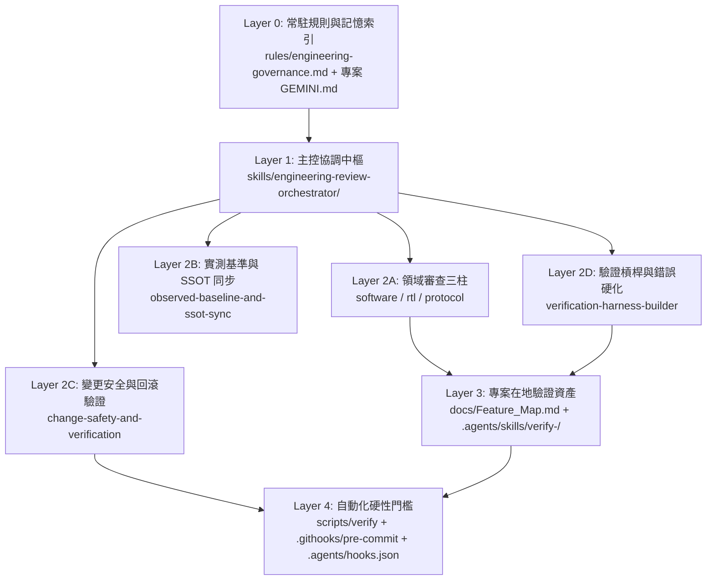
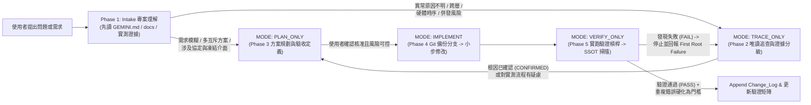

# 技能應用架構流程與使用詳解 (Architecture & Workflow Guide)

本文件說明 `Antigravity-IDE-Auto-Setting` 各層規則、7 大全域技能與專案在地驗證資產之間的**架構分工、工作模式切換（MODE）、五階段閉環流程、實戰導入路線與護欄連動機制**。

---

## 一、 系統總體分層架構

本套件採用 **「全域長駐紅線 + 按需載入技能（Progressive Disclosure）+ 專案在地驗證槓桿」** 的四層架構：

### 各層職責邊界
1. **Layer 0（常駐層）**：`rules/engineering-governance.md`（全域自動生效）與各專案 `GEMINI.md`（專案地圖索引）。刻意保持極度精簡，避免塞滿長篇大論稀釋模型注意力。
2. **Layer 1（中樞層）**：`engineering-review-orchestrator` 讀取專案實證檔案（`*.sln`、`*.v`、`CMakeLists.txt`、`package.json` 等）自動判斷技術棧與工作模式（MODE），並按需調用專業技能。
3. **Layer 2（專業與治理層）**：涵蓋領域審核（軟體 / RTL / 協定）、實測防漂移（Replicate-First + SSOT）、版本安全（Git-only 回滾 + Append-Only）與驗證槓桿建置。
4. **Layer 3 & 4（專案落地與硬性攔截層）**：將規範具體轉化為每個專案可實跑的 `docs/Feature_Map.md`、`.agents/skills/verify-<project>/`、一鍵腳本與 Git / Agent Hook，用決定性工具輸出取代口頭承諾。

---

## 二、 工作模式切換（MODE）與五階段標準閉環

每次對話開頭強制標示當前 `MODE`，並依下列狀態機推進，**不可跳過蒐證直接盲改**：

### 四種 MODE 觸發與嚴格禁令

| MODE | 觸發條件 | 允許動作 | 絕對禁止事項 |
|---|---|---|---|
| `TRACE_ONLY` | 原因不明的 Bug、跨層異常、硬體時序疑慮，或僅描述症狀未要求改碼 | 唯讀追蹤檔案/Symbol/Log、區分 `CONFIRMED` / `INFERRED` / `UNKNOWN` | **禁止猜測性修改任何產品程式碼或 RTL** |
| `PLAN_ONLY` | 需求含糊、存在多方案取捨、可能改動凍結黃金路徑、或懷疑抓包/實測步驟冗餘 | 產出候選方案、影響範圍、`Suspicious Behavior Report` 與可量測驗收標準 | **禁止先斬後奏擅自增刪實測控制步驟** |
| `IMPLEMENT` | 需求與邊界明確且已取得執行授權 | 先建 Git 備份分支/Tag → 分階段最小變更 → 保持乾淨 Diff（Unslop） | **禁止在 Git 專案複製實體備份資料夾**；禁止順手改寫無關檔案 |
| `VERIFY_ONLY` | 要求執行測試、模擬、Lint、檢查 Diff 或結案驗收 | 執行驗證腳本/Sim/UI 工具、比對 `Feature_Map.md`、更新紀錄 | **禁止修改產品碼掩蓋測試失敗**；未實跑項目不得宣稱 `PASS` |

---

## 三、 7 大全域技能 ＋ 1 在地技能詳解

| 技能名稱 | 觸發時機與定位 | 搭配之關鍵模板 / 清單 | 核心防呆規則與連動 |
|---|---|---|---|
| `engineering-review-orchestrator` | **主控入口**：任何異常排查、重構、開發規劃或審核皆優先載入 | `skills/engineering-review-orchestrator/resources/trace-report-template.md`、`skills/engineering-review-orchestrator/resources/change-plan-template.md` | 負責專案類型識別、MODE 判定、Phase 1–5 調度、高風險獨立盲審與統一 7 區塊輸出格式 |
| `software-architecture-review` | **軟體與桌面 UI**：C#/WPF/MVVM、C++、Python、JS/TS、Web API | `skills/software-architecture-review/resources/software-checklist.md` | 查呼叫鏈、非同步 `CancellationToken`/鎖、`IDisposable`、UI `Dispatcher` 與錯誤硬化至 `.editorconfig`/Analyzer |
| `rtl-hardware-review` | **硬體與 FPGA**：Verilog/SystemVerilog/VHDL、Testbench、SDC/XDC | `skills/rtl-hardware-review/resources/rtl-checklist.md` | 查 Clock/Reset/CDC/RDC、握手 `valid/ready`、位寬符號、`<=` vs `=`、Latch 與 `verilator`/Batch Sim 硬化 |
| `protocol-stack-contract-review` | **通訊協定與軟硬體介面**：USB/FT601Q、eDP AUX、I2C/SPI、Register Map | `skills/protocol-stack-contract-review/resources/protocol-checklist.md` | 查單一正式通道、Length 單位與對齊、TL ACK vs AL 語義完成、分片重組、暫存器副作用與 Golden Trace Replay |
| `observed-baseline-and-ssot-sync` | **實測逆向與防漂移**：LA/示波器/Sniffer 實測、多輪修正後規格同步 | `skills/observed-baseline-and-ssot-sync/resources/baseline-ssot-checklist.md`、`skills/observed-baseline-and-ssot-sync/resources/suspicious-behavior-report-template.md` | **先 100% 原樣仿照，後外層變通**；有可疑停 `PLAN_ONLY` 提報；修正確認後強制回溯掃描同步舊檔與複本 |
| `change-safety-and-verification` | **變更安全與紀錄**：任何改碼實作、回滾備份與驗證結案強制調用 | `skills/change-safety-and-verification/resources/verification-template.md` | **Git 優先備份（嚴禁實體拷貝）**、最小純淨 Diff（Unslop）、`Change_Log` Append-Only、`Regression` vs `New Behavior` 證據分離 |
| `verification-harness-builder` | **可執行槓桿與硬化**：開新/納管/升級專案、建置驗收腳本與重複錯誤升級 | `skills/verification-harness-builder/resources/feature-map-template.md`、`skills/verification-harness-builder/resources/verify-skill-template.md`、`skills/verification-harness-builder/resources/guardrail-snippets.md` | 為專案產出 `docs/Feature_Map.md` 與 `.agents/skills/verify-<project>/`，區分 `Doc Drift` vs `Product Bug`，推動 Prose → Guardrail 硬化 |
| `verify-antigravity-ide-auto-setting` | **本倉庫自我驗證（範例）**：修改本全域設定庫時執行之在地技能 | `scripts/verify-repo.ps1`、`.githooks/pre-commit`、`docs/Feature_Map.md` | 示範如何以自動化腳本＋負向夾具測試＋Pre-Commit Hook 守護規則庫本身不漂移 |

---

## 四、 專案導入與「差分增量升級」實戰路線

依照專案所處狀態，建議於**該專案自己的獨立工作區視窗**執行對應流程（詳見 `templates/project-onboarding-prompts.md`）：

1. **情境 1 — 全新專案從零開發**
   - `git init` ＋ `.gitignore` → 建立骨架、`GEMINI.md`、`docs/Feature_Map.md`、`Change_Log.md`、`VerificationCoverageMatrix.md` → 設定編譯/Lint 嚴格門檻與 `.agents/skills/verify-<project>/` → 實跑 Stage 1 驗證後綁定同名 GitHub 私人倉。
2. **情境 2 — 本機既有舊專案納管至 GitHub**
   - 先做 Git Baseline（不複製實體備份資料夾）→ 全程 `MODE: TRACE_ONLY` 唯讀逆向分析，產出 `docs/01~03`（RTL/軟體/協定）與 `docs/04_Feature_and_Verification_Map.md` → 建置 `GEMINI.md`、`.agents/skills/verify-<project>/`、`Change_Log.md` 與 `VerificationCoverageMatrix.md`。
3. **情境 3 — 已有規範專案「差分增量升級（Delta Upgrade）」**
   - **不推翻舊有 `docs/01~03` 與歷史紀錄**！先挑 **1 個主力試點專案**，僅針對新增機制做增量補齊：
     1. 於 `GEMINI.md` 補入 `Tier 1 > Tier 2 > Tier 3` 優先序並掃描過時文件漂移；
     2. 補建 `docs/Feature_Map.md` 與 `.agents/skills/verify-<project>/SKILL.md` 整合既有建置/模擬/重播指令；
     3. 從 `Change_Log.md` 挑選 1~3 個曾重複發生的問題，參照 `skills/verification-harness-builder/resources/guardrail-snippets.md` 硬化為編譯/Lint/Test/Pre-Commit 門檻。
   - 待該試點專案跑順並將摩擦點反哺回本設定庫後，再複製推廣至其他專案。

---

## 五、 與 Antigravity 內建能力協同建議

- **跨層大專案追查（`TRACE_ONLY`）**：善用唯讀 `research` 子代理平行追蹤上位機呼叫鏈與 FPGA RTL/協定解析路徑，防止主對話視窗被大量檔案塞滿。
- **模糊需求對齊（`PLAN_ONLY`）**：可搭配 Antigravity 的 `/plan` 或 `/grill-me` 先把規格邊界與驗收條件問透再動工。
- **Web 前端驗收（`VERIFY_ONLY`）**：搭配 `browser` 子代理實測頁面操作、DOM 渲染、Console Errors 與 Network 請求。
- **高風險獨立盲審**：大範圍修改後，建議另開乾淨上下文或子代理，僅檢視「驗收標準 ＋ `git diff` ＋ 驗證槓桿實際輸出」進行複核，降低確認偏誤。
